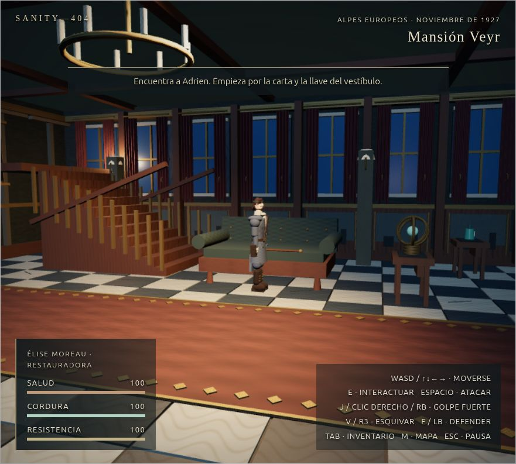
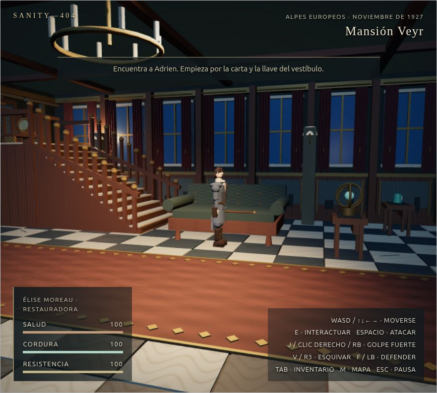

# Fase 10 — Mansión de 1927, presentación y estabilidad

## Dirección y auditoría visual

La referencia es el lenguaje de un juego 3D de sexta generación: arquitectura legible, siluetas construidas, materiales con dibujo visible, encuadres por zona, luces cálidas contra noche fría y terror psicológico dentro de la ficción. Se conservaron el nombre SANITY-404, sus tres épocas, controles, combate, guardado, puzles, opciones de accesibilidad y eventos de cordura. No se añadieron recursos de otro juego.

Las capturas **antes** se tomaron en Chrome visible con la escena original y partidas sembradas en 1927. [Entrada](capturas/fase10/before/entrada.jpg), [escalera desde el salón](capturas/fase10/before/escalera.jpg) y [evento de cordura](capturas/fase10/before/cordura.jpg). La escena ya tenía muebles, cortinas, retratos, texturas procedurales, Élise articulada y cámara clásica. La escalera, sin embargo, era un volumen bloqueado y no había vista ni interacción en altura. En la toma del salón, sus peldaños y el pasamanos no conducían a un espacio jugable.

Las capturas **después** usan el mismo estado, calidad Baja y cámara clásica para la comparación del salón: [escalera desde el salón](capturas/fase10/after/escalera-exterior.jpg). Otras capturas reales muestran el recorrido: [tramo de escalera](capturas/fase10/after/escalera.jpg), [rellano](capturas/fase10/after/rellano.jpg), [pista astral](capturas/fase10/after/pista.jpg), [enemigo](capturas/fase10/after/combate.jpg), [caja astronómica](capturas/fase10/after/puzle.jpg) y [aparición](capturas/fase10/after/cordura.jpg). La revisión visual detectó y corrigió una cámara que se acercaba demasiado al personaje al cruzar una barandilla. El encuadre final permanece dentro del hueco de la escalera. Las capturas son del navegador real; las finales identificaron `ANGLE (Intel, Mesa Intel(R) HD Graphics 620 (KBL GT2), OpenGL 4.6)`.

| Antes: escalera decorativa bloqueada                                             | Después: escalera y galería transitables                                               |
| -------------------------------------------------------------------------------- | -------------------------------------------------------------------------------------- |
|  |  |

## Reconstrucción funcional

- La escalera oriental ahora tiene doce peldaños transitables, huellas de piedra, contrahuellas talladas, largueros, balaustres, remates de latón y un rellano superior. Un campo de altura determinista calcula la elevación a partir de `x,z`; los guardados antiguos no necesitan migración. Las barandillas y el cierre del rellano impiden salir lateralmente del recorrido.
- La galería incorpora una carta astral enmarcada, marcas de calibración y un lente sobre un atril. El objeto interactivo del rellano da una pista coherente para la caja astronómica de la planta baja; el puzle original sigue disponible. Los objetos de planta baja no se pueden accionar desde la galería.
- La cámara clásica tiene encuadres propios para subida y rellano, con foco a la altura real de Élise. La cámara moderna conserva seguimiento y también ajusta altura. La sombra de contacto sigue al personaje sobre la escalera.
- Los pasos en la escalera tienen un tono y duración propios dentro del sintetizador existente. El viento, lluvia, ambiente, combate y sonidos psicológicos siguen activos. Élise mantiene su rig animado y el enemigo conserva su IA y combate.
- La aparición psicológica estática agrupa mallas por material sin cambiar triángulos ni silueta; durante `mansion-echo` se observaron 109 llamadas de dibujo antes y 94 después. La arquitectura nueva separa los lotes según índice y atributos de geometría para evitar que `mergeGeometries` descarte decoración.

El recorrido se verificó en el navegador con entradas de teclado: desde `(5,4; 0,8)` Élise alcanzó `(5,4; -6,22)` y altura `2,64`; abrió «La bóveda de las cenizas»; el desplazamiento lateral se detuvo en la barandilla; al bajar volvió a altura `0`. La cámara indicó `rellano superior` sin corrección de colisión. La consola del navegador quedó sin errores.

## Investigación del descenso psicológico de 1927

La [pasada de Fase 9](capturas/fase9/hardware-60s.json) registró **37,91 FPS** en la peor ventana de 60 intervalos del escenario psicológico. Otra [pasada parcial](capturas/fase10/hardware-pass1.json) bajó a 30,52 FPS cerca del segundo 55, mientras el evento empezó en el 7,62. La [primera línea base de Fase 10](capturas/fase10/baseline-1927-60s.json) tuvo 40,92 FPS cerca del segundo 34; el evento empezó en el 7,54. Estas caídas no coinciden con el inicio de la aparición. Una repetición sin agrupación de mallas dio 55,40 FPS en la peor ventana, así que la mejora global entre pasadas no se atribuye a esa optimización.

Una medición de 10 s con otra partida 3D abierta en la misma GPU bajó a 26,09 FPS en la peor ventana; al dejar esa pestaña en blanco, la misma escena dio 49,3 FPS en 10 s y [54,6 FPS en 60 s](capturas/fase10/vertical-psych-60s.json). Esta interferencia explica esa **muestra concreta**. No identifica con certeza la causa de las caídas históricas ni garantiza sesiones largas. El benchmark rechaza SwiftShader y otros renderizadores por software; registra GPU, errores, eventos y peor bloque de 60 intervalos, e invalida las filas por debajo de 45 FPS.

## Rendimiento de la reconstrucción

Equipo medido: Intel HD Graphics 620 (KBL GT2), Linux Mint, Chrome 155 visible en X11, WebGL 2 sobre ANGLE/OpenGL, ventana 1280 × 720, canvas 1024 × 576, perfil Bajo. Cada escenario duró 60 s. El [JSON final](capturas/fase10/vertical-hardware-60s.json) tiene nueve filas con `gpuType: physical`, `scenarioValid: true`, `performancePass: true` y `errors: []`.

| Época | Escenario   | Fase 9: peor 60 | Fase 10 previa al cambio visual | Mansión reconstruida: peor 60 | Media final |
| ----- | ----------- | --------------: | ------------------------------: | ----------------------------: | ----------: |
| 1927  | Exploración |           59,03 |                           60,02 |                         59,03 |       59,99 |
| 1927  | Combate     |           50,02 |                           52,19 |                     **48,67** |       55,77 |
| 1927  | Psicológico |       **37,91** |                           55,40 |                         50,72 |       56,57 |
| 189   | Exploración |           60,01 |                           60,02 |                         60,01 |       60,02 |
| 189   | Combate     |           59,03 |                           52,19 |                         52,96 |       59,71 |
| 189   | Psicológico |           59,03 |                           59,03 |                         55,40 |       59,56 |
| 1348  | Exploración |           48,67 |                           60,02 |                         60,01 |       60,02 |
| 1348  | Combate     |           58,08 |                           55,41 |                         54,56 |       58,42 |
| 1348  | Psicológico |           59,03 |                           58,08 |                         55,40 |       59,84 |

La pasada previa al cambio visual está en [hardware-60s.json](capturas/fase10/hardware-60s.json). La reconstrucción añade geometría y tiene un coste visible en 1927: la peor ventana de combate bajó de 52,19 a 48,67 FPS en estas pasadas distintas. Las nueve filas finales superaron 45 FPS, pero el menor margen fue de 3,67 FPS y la variación entre pasadas sigue siendo un riesgo. El archivo [hardware-60s-final.json](capturas/fase10/hardware-60s-final.json) es una **pasada incompleta y fallida** de una ejecución anterior; no se usa para la tabla final.

## Pruebas y reproducción

- `npm test`: pruebas unitarias de mundo, cámara, altura, colisión, audio, lote de geometrías, cordura y benchmark.
- `npm run build`: comprobación TypeScript y compilación de producción.
- `npm run format:check`: formato de código.
- Navegador real: capturas antes/después, subida y bajada con teclado, pista, enemigo, puzle, evento de cordura y consola sin errores. La suite automatizada completa de navegador pasó antes de la reconstrucción; al repetirla después, Chrome headless terminó con `SIGTRAP` de Crashpad en este sandbox. La validación manual en Chrome visible y la pasada completa física sí se ejecutaron después del cambio.
- Benchmark final: `node scripts/performance-phase10.mjs --url=http://127.0.0.1:5190/ --seconds=60 --headed --hardware --output=docs/capturas/fase10/vertical-hardware-60s.json`. Inicie antes Vite en el puerto indicado. Mantenga cerradas otras pestañas 3D y tareas intensivas. Compruebe las nueve filas y el identificador WebGL sin máscara.

## Riesgos y estado de Git

Quedan por repetir sesiones largas, más pasadas térmicas y revisión humana de audio con altavoces, controles físicos y legibilidad a otras resoluciones. La meta de 45 FPS se cumplió en la pasada final de nueve escenarios, con margen estrecho en combate de 1927. No se afirma que todas las condiciones de uso estén cubiertas.

`.git` tiene acceso de solo lectura en este entorno. `git switch fase10/rendimiento-estabilidad` falló al crear `.git/index.lock`, por lo que los cambios permanecen en el árbol de trabajo de `main` sin commits. No se hizo push ni merge.

Skills utilizadas: `ecc:frontend-design-direction` para dirección y comparación visual; `ecc:browser-qa` para capturas, controles y consola; `ecc:change-impact` para revisar cámara, mundo, colisiones, audio, pruebas y documentación; `ecc:benchmark-optimization-loop` para medir la variante visual con la misma carga.
