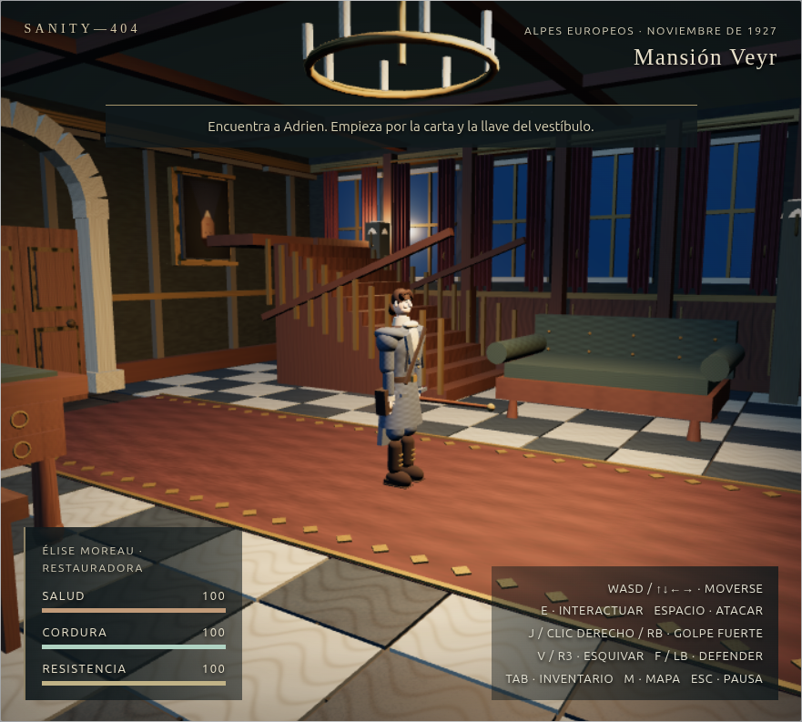
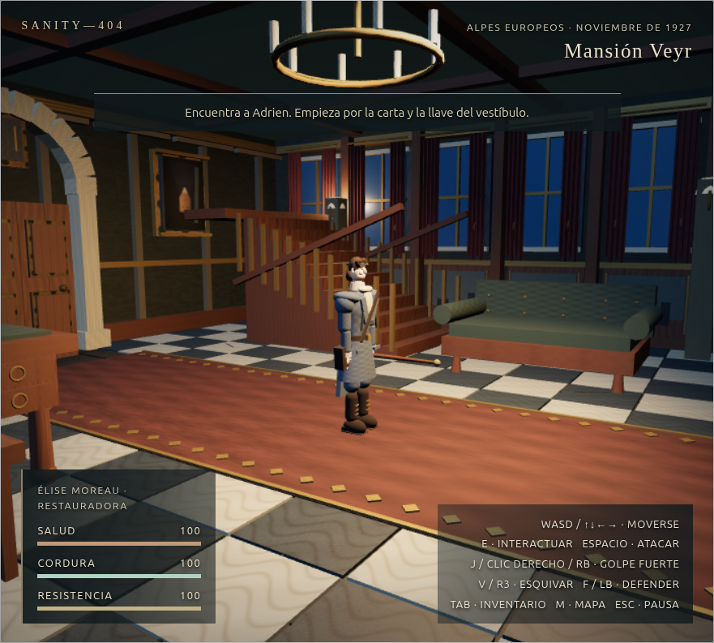
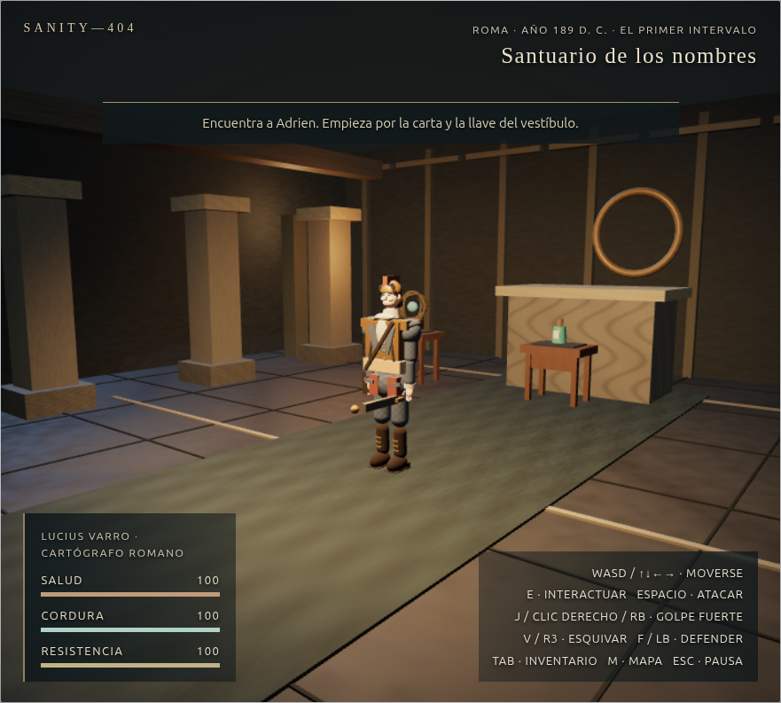
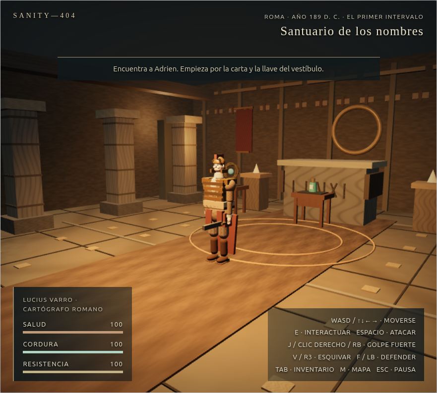
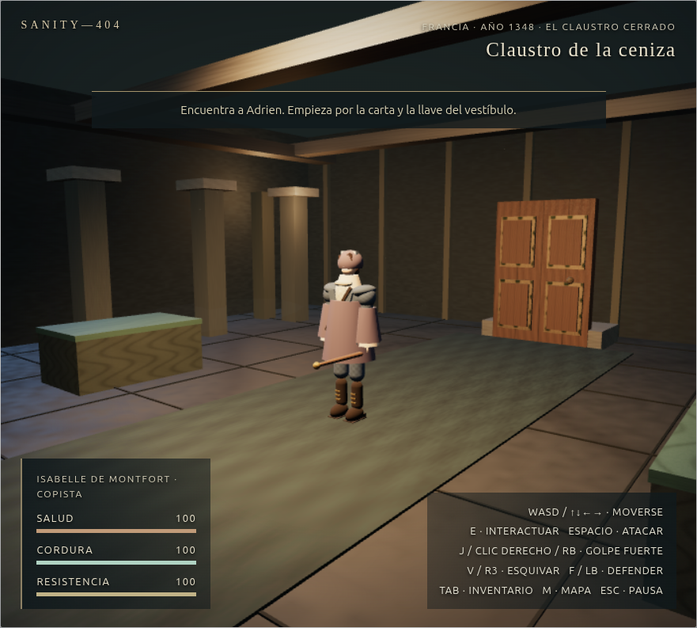
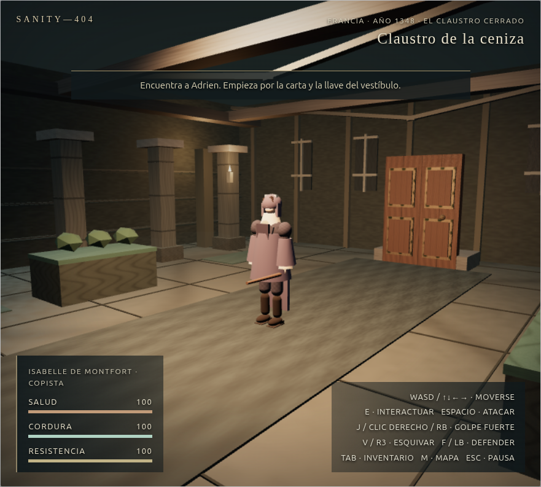
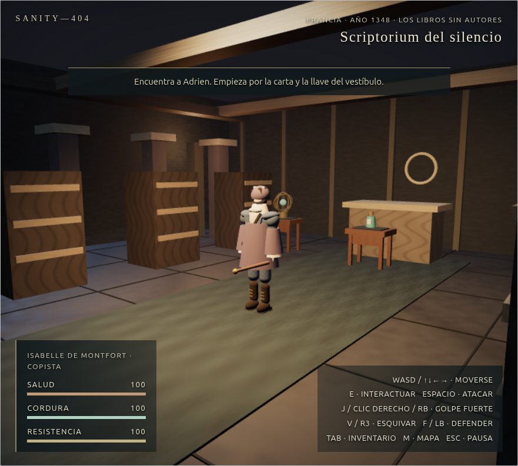
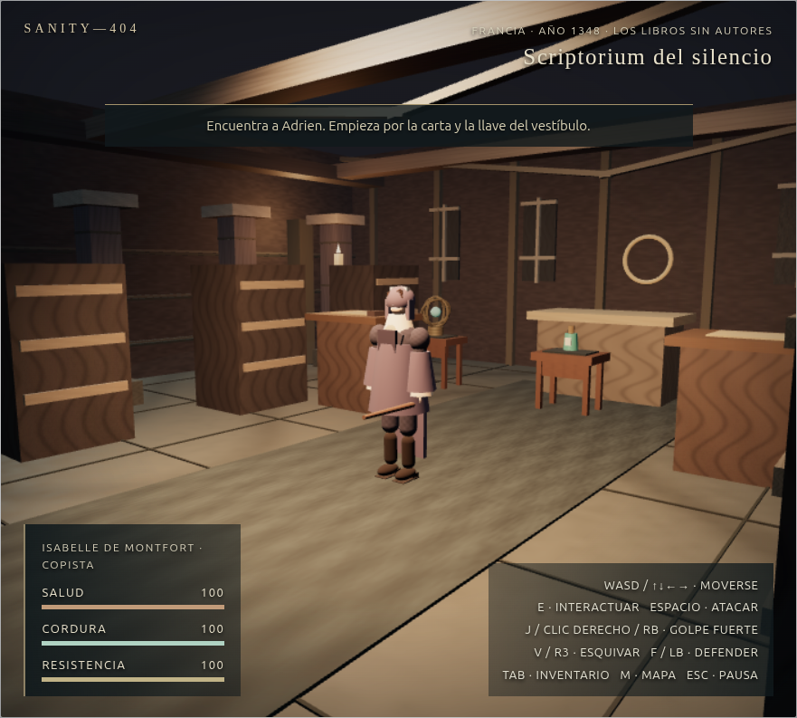

# Fase 6 — remasterización visual

## Arquitectura y alcance

Partimos de `main` en `f4db66d`, ya con la Fase 5 incorporada y el árbol limpio. `World` conserva las once salas, las interacciones, la progresión y el formato de guardado v1. `src/world` crea arquitectura y personajes articulados; `src/render` gestiona materiales, atmósfera, luz y perfiles; `CinematicCamera` encuadra la acción. No se añadieron dependencias ni recursos de terceros. La línea base de Fase 5 está en [FASE5.md](FASE5.md).

## Cambios implementados

| Área | Resultado |
| --- | --- |
| Mansión Veyr | Paneles afectados por humedad, manchas, grietas de suelo y dinteles, reloj deteriorado y sombrero de fieltro para Élise. Se conserva el mobiliario, el damero y la composición original. |
| Roma, 189 | Piedra con juntas y acanaladuras, mosaico de paso, friso, estandartes, incisiones del altar, círculo ceremonial y llamas constantes. Luz principal y polvo con paleta cálida. Lucius lleva coraza por bandas, casco, capa y grebas sobre el rig de combate. |
| Francia, 1348 | Columnas erosionadas, nervios de bóveda más discretos, humedad en muros, ventanas estrechas, velas, plantas instanciadas en el claustro y mesas con pergaminos en el scriptorium. Isabelle viste túnica, escapulario y capucha animados. |
| Cámara | La cámara de entrada a las salas 8–10 queda delante del portal de regreso; antes el portal tapaba gran parte de la escena y del personaje. |
| Animación | Balanceo lateral leve de cadera, contrapeso de cabeza, movimiento de hombros y faldones. Se conserva la interpolación de marcha, carrera, ataque, defensa, impacto y muerte. |
| Escalabilidad | La geometría estática se agrupa por material, las hierbas usan `InstancedMesh`, las llamas comparten geometría y material, y las texturas procedurales siguen cacheadas. El perfil Bajo conserva las sombras desactivadas y la resolución interna limitada; las partículas se ocultan con efectos reducidos. No hay destellos ni parpadeos de luz. |

Los nuevos pedestales y escritorios con colisión se colocaron fuera del corredor central. Las inscripciones y decoraciones planas no bloquean el movimiento. El modelo y los objetos de cada protagonista siguen siendo parte del mismo rig jugable.

## Comparativas visuales

Capturas de Chrome con el personaje en `(0,0)`, cámara clásica, perfil Bajo, enemigo derrotado y el mismo viewport. Los archivos completos están en `docs/capturas/fase6/`.

| Escena | Antes (`main`) | Después |
| --- | --- | --- |
| Mansión |  |  |
| Roma |  |  |
| Claustro |  |  |
| Scriptorium |  |  |

La corrección del encuadre se ve también en las parejas `antes-roma.png` / `despues-roma.png` y `antes-claustro.png` / `despues-claustro.png`, tomadas desde la entrada `(0,5)`.

## Rendimiento y memoria

Medimos en **Intel HD Graphics 620 (KBL GT2)** mediante Chrome/ANGLE OpenGL 4.6. Baseline y remaster se sirvieron desde el mismo puerto, con el mismo navegador, viewport 881 × 793, canvas interno 704 × 634, perfil Bajo, cámara clásica, personaje en `(0,0)`, enemigo derrotado y 180 intervalos `requestAnimationFrame` por sala. Cada sala tuvo una pasada tras cargarla y esperar aproximadamente 1,2 s. Datos crudos: [baseline-center.json](capturas/fase6/baseline-center.json) y [remaster-center.json](capturas/fase6/remaster-center.json).

| Sala | FPS antes → después | P95 / P99 antes → después (ms) | Draw calls antes → después | Geometrías / texturas antes → después |
| --- | ---: | ---: | ---: | ---: |
| Mansión | 60,02 → 60,02 | 16,7 / 16,8 → 16,7 / 16,8 | 55 → 60 | 55 / 14 → 60 / 14 |
| Roma | 60,02 → 59,69 | 16,7 / 16,8 → 16,7 / 16,8 | 62 → 74 | 62 / 14 → 73 / 14 |
| Claustro | 60,02 → 60,02 | 16,7 / 16,8 → 16,7 / 16,8 | 53 → 62 | 53 / 14 → 62 / 14 |
| Scriptorium | 60,02 → 60,02 | 16,7 / 16,8 → 16,7 / 16,8 | 61 → 72 | 61 / 14 → 72 / 14 |

Las llamadas de dibujo aumentan por los elementos nuevos. Las muestras quedan cerca del límite de 60 FPS y **no prueban una mejora de rendimiento**; tampoco bastan para descartar degradación en sesiones largas o escenas de combate. Una exploración intermedia aislada dio 51,94 FPS en la mansión, mientras que cuatro pasadas posteriores de esa versión dieron 58,72–59,69 FPS: hay ruido de carga y sincronización. El heap JavaScript sin forzar GC osciló entre unos 27 y 44 MB en las muestras centrales; no permite inferir fugas ni ahorro de memoria. Las texturas WebGL permanecieron en 14 por sala.

Para repetir el escenario con Playwright en un entorno que permita lanzar Chrome: `SANITY_BENCH_URL=http://127.0.0.1:5173/ node scripts/performance-phase6.mjs --runs=2 --frames=240`. Cambiar `SANITY_BENCH_OUTPUT` para guardar el JSON de cada revisión. El script configura la misma escena y viewport, pero abre un contexto nuevo por pasada; por eso sus cifras de heap no deben mezclarse directamente con las tomas DevTools anteriores.

## QA y límites

- `npm ci`: 57 paquetes instalados; cero vulnerabilidades informadas por npm.
- `npm run format:check`, `npm test` (**75/75**) y `npm run build`: ejecutados tras los cambios. Las pruebas cubren la cámara histórica, los corredores y puzles, la articulación de los héroes y los efectos reducidos, además de los guardados v1 ya cubiertos por el proyecto.
- `npm run test:browser`: campaña original completa, ambos desenlaces, guardado/carga, colisiones, combate, muerte/reintento, cordura y ajustes reducidos; sin errores JavaScript.
- Chrome real: inspección y capturas de las cuatro salas; portales 1927→189 y 1927→1348; puzles romano y medieval; recogida de tablilla y códice; guardado en escritorio y recarga; golpe contra el centurión y defensa. El golpe bajó su salud de 115 a 85 en la prueba observada.
- `vite preview`: mansión, Roma, claustro y scriptorium con WebGL activo, HUD correcto y sin errores de consola observados. El observador de desarrollo no aparece en producción.
- El guion histórico Playwright no pudo completarse aquí: el lanzamiento directo de Chrome produjo `SIGTRAP` y una segunda ejecución encadenada se interrumpió tras varios minutos sin salida de ese guion. La prueba histórica manual en Chrome sí pasó. El guion conserva su ejecución en el trabajo de CI y ahora elige el binario de Playwright cuando está instalado o el Chrome del sistema como alternativa.
- La ejecución directa del benchmark Playwright con Chrome y el perfil de GPU del script también falló al arrancar con `SIGTRAP` dentro de este sandbox. Las mediciones informadas proceden del Chrome accesible mediante DevTools. Una sesión prolongada y pruebas físicas de mando/Windows siguen fuera de este alcance.

La creación de la rama, los commits y la PR requieren escritura en `.git` o en GitHub. La política de este entorno bloqueó ambas operaciones; el árbol de trabajo contiene los cambios verificados para entregarlos cuando se habilite esa capacidad.
